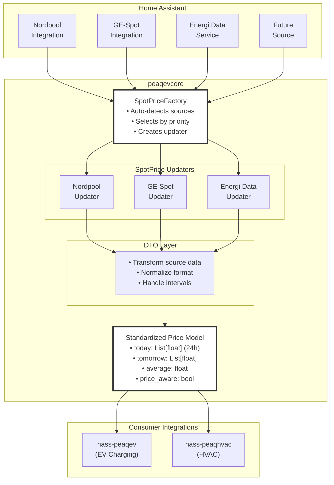
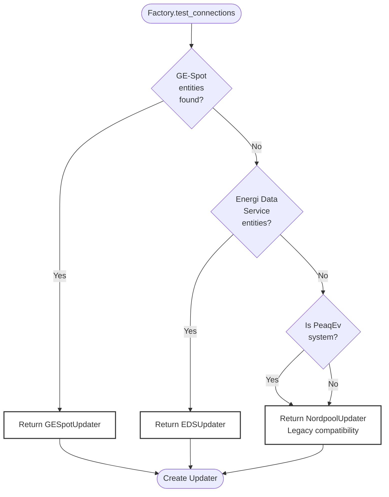
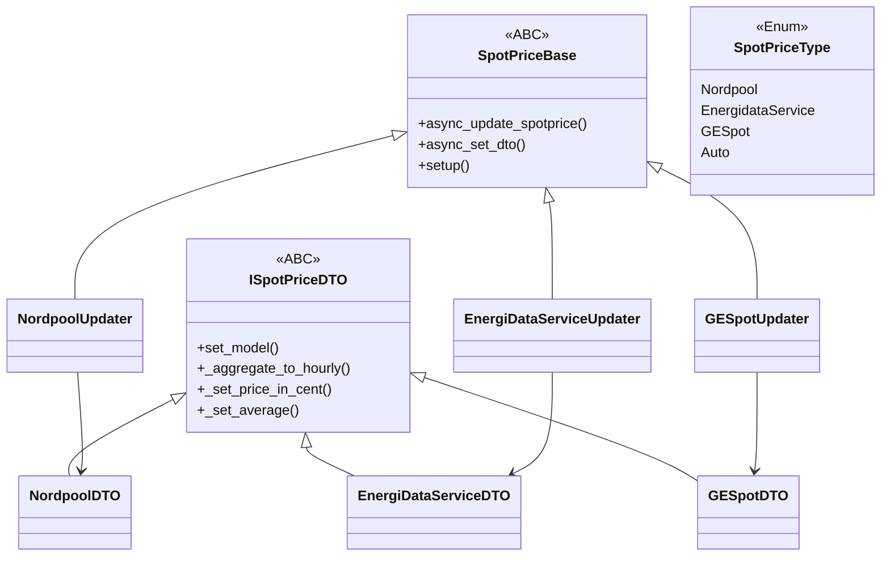
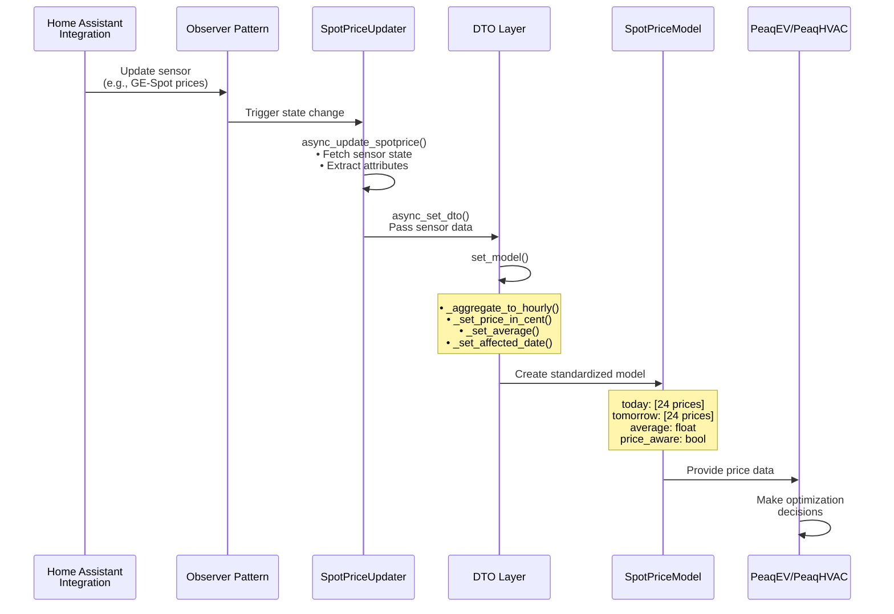

# peaqevcore Architecture Overview

**Audience**: Integration developers and core contributors  
**Last Updated**: October 2025  
**Version**: 19.12.0+

---

## Table of Contents

1. [System Overview](#system-overview)
2. [Spot Price Architecture](#spot-price-architecture)
3. [Component Hierarchy](#component-hierarchy)
4. [Data Flow](#data-flow)
5. [Extension Points](#extension-points)

---

## System Overview

peaqevcore is a **shared library** that provides electricity price management services for Home Assistant integrations. It's designed to be price-source agnostic, allowing multiple electricity price integrations to coexist.

### High-Level Architecture



---

## Spot Price Architecture

### Core Components

#### 1. **SpotPriceFactory**
- **Location**: `peaqevcore/common/spotprice/spotprice_factory.py`
- **Responsibility**: Detect and instantiate the appropriate price updater
- **Key Method**: `test_connections(hass, spotprice_type, system, custom_sensor)`

**Detection Logic**:



#### 2. **SpotPriceUpdater** (Abstract Base)
- **Location**: `peaqevcore/common/spotprice/spotpricebase.py`
- **Implementations**:
  - `NordpoolUpdater` - Nordic countries
  - `EnergiDataServiceUpdater` - Denmark
  - `GESpotUpdater` - Multi-region (EU, Nordic, others)

**Common Interface**:
```python
class SpotPriceBase(ABC):
    async def async_update_spotprice()  # Get latest prices
    async def async_set_dto()            # Transform data via DTO
    async def setup()                    # Discover entities
```

#### 3. **SpotPriceDTO** (Data Transfer Object)
- **Location**: `peaqevcore/common/spotprice/models/spotprice_dto.py`
- **Implementations**:
  - `NordpoolDTO`
  - `EnergiDataServiceDTO`
  - `GESpotDTO`

**Responsibilities**:
- Parse source-specific data structures
- Transform intervals (e.g., 96 × 15-min → 24 × hourly)
- Detect price units (cents vs currency)
- Calculate averages
- Normalize to standard model

---

## Component Hierarchy

### Class Inheritance



### File Structure

```
peaqevcore/
├── common/
│   └── spotprice/
│       ├── const.py              # Constants (NORDPOOL, GESPOT, etc.)
│       ├── spotpricebase.py      # Abstract base class
│       ├── nordpool.py           # Nordpool implementation
│       ├── energidataservice.py  # EnergiDataService implementation
│       ├── gespot.py             # GE-Spot implementation
│       ├── spotprice_factory.py  # Factory for auto-detection
│       └── models/
│           ├── spotprice_type.py # Enum for price types
│           ├── spotprice_dto.py  # DTO implementations
│           └── spotprice_model.py# Data model
└── tests/
    ├── test_nordpool.py
    ├── test_energidataservice.py
    ├── test_gespot.py
    └── test_spotprice_factory_gespot.py
```

---

## Data Flow

### Typical Price Update Cycle



---

## Extension Points

### Adding a New Price Source

To add support for a new electricity price integration (like we did with GE-Spot):

**Step 1**: Add constant
```python
# peaqevcore/common/spotprice/const.py
YOUR_SOURCE = "your_source"
```

**Step 2**: Add enum
```python
# peaqevcore/common/spotprice/models/spotprice_type.py
class SpotPriceType(str, Enum):
    YourSource = YOUR_SOURCE
```

**Step 3**: Create DTO
```python
# peaqevcore/common/spotprice/models/spotprice_dto.py
class YourSourceDTO(ISpotPriceDTO):
    def set_model(self, ...):
        # Transform your source's data format
```

**Step 4**: Create Updater
```python
# peaqevcore/common/spotprice/yoursource.py
class YourSourceUpdater(SpotPriceBase):
    def __init__(self):
        super().__init__(source=YOUR_SOURCE)
    
    async def setup(self, ...):
        # Discover entities
    
    async def async_set_dto(self, ...):
        # Use YourSourceDTO
```

**Step 5**: Update Factory
```python
# peaqevcore/common/spotprice/spotprice_factory.py
from .yoursource import YourSourceUpdater

sources = {
    SpotPriceType.YourSource: YourSourceUpdater,
    # ... existing sources
}

def test_connections(...):
    # Add detection logic for your source
```

**Step 6**: Write Tests
```python
# peaqevcore/tests/test_yoursource.py
# - DTO transformation tests
# - Updater initialization tests
# - Factory integration tests
```

See [Adding a New Price Source](spotprice/ADDING_NEW_SOURCE.md) for detailed guide.

---

## Design Decisions

### Why Factory Pattern?

The `SpotPriceFactory` allows **automatic detection** of available price sources without requiring user configuration. Users just install the price integration they want, and peaqevcore automatically uses it.

### Why DTO Layer?

Different price integrations have different data formats:
- **Nordpool**: Hourly prices directly
- **GE-Spot**: 15-minute intervals (96 per day)
- **EnergiDataService**: Hourly with specific attributes

The DTO layer **normalizes** these differences into a standard format.

### Why Priority System?

When multiple price sources are available, the factory chooses based on:
1. **GE-Spot** (most flexible, multi-region)
2. **EnergiDataService** (Denmark-specific, official)
3. **Nordpool** (Nordic countries, well-established)

Exception: PeaqEv system prefers Nordpool for legacy compatibility.

---

## Performance Considerations

- **Lazy Loading**: Updaters only created when needed
- **Async Operations**: All price updates are async
- **Caching**: Price data cached until next update cycle
- **Observer Pattern**: Efficient state change detection

---

## Security & Privacy

- No external API calls from peaqevcore
- All data comes from local Home Assistant entities
- No personal data collected or transmitted
- Price data stays within Home Assistant

---

## Next Steps

- **For Integration Developers**: Read [Spot Price System](spotprice/README.md)
- **For Adding New Sources**: Read [Adding a New Price Source](spotprice/ADDING_NEW_SOURCE.md)
- **For GE-Spot Details**: Read [GE-Spot Integration](spotprice/GE_SPOT.md)
