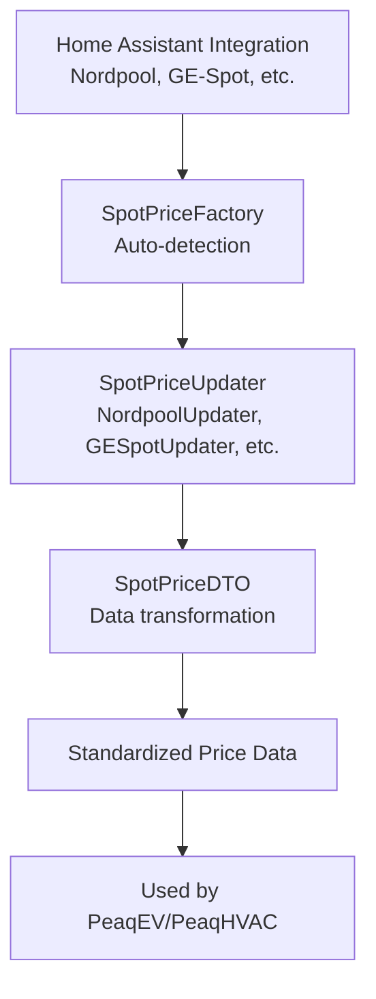

# peaqevcore Documentation

**Version**: 19.12.0+  
**Updated**: October 2025

---

## Welcome to peaqevcore

peaqevcore is the core library for the Peaq ecosystem of Home Assistant integrations, providing shared services for intelligent electricity management based on dynamic pricing.

**Used by**:
- [hass-peaqev](https://github.com/elden1337/hass-peaq) - EV charging optimization
- [hass-peaqhvac](https://github.com/elden1337/hass-peaqhvac) - HVAC optimization

---

## 📚 Documentation Structure

### Getting Started
- [Architecture Overview](ARCHITECTURE.md) - Understanding the system design
- [Spot Price System](spotprice/README.md) - How electricity pricing works
- [Adding a New Price Source](spotprice/ADDING_NEW_SOURCE.md) - Developer guide

### Spot Price Integrations
- [Supported Price Sources](spotprice/SUPPORTED_SOURCES.md) - Nordpool, EnergiDataService, GE-Spot
- [GE-Spot Integration](spotprice/GE_SPOT.md) - Detailed GE-Spot documentation
- [SpotPriceFactory](spotprice/FACTORY.md) - How price source detection works
- [Data Transformation](spotprice/DTO.md) - Understanding DTOs

### API Reference
- [SpotPriceBase](spotprice/API_SPOTPRICE_BASE.md) - Base class for price updaters
- [ISpotPriceDTO](spotprice/API_DTO.md) - Data transfer object interface

---

## Quick Links

**For Integration Developers** (using peaqevcore in your HA integration):
→ Start with [Architecture Overview](ARCHITECTURE.md)
→ Then read [Spot Price System](spotprice/README.md)

**For Core Contributors** (adding features to peaqevcore):
→ Start with [Adding a New Price Source](spotprice/ADDING_NEW_SOURCE.md)
→ Review the [GE-Spot Implementation](spotprice/GE_SPOT.md) as a reference

**For Troubleshooting**:
→ Check [Supported Price Sources](spotprice/SUPPORTED_SOURCES.md)
→ Review [SpotPriceFactory](spotprice/FACTORY.md) for detection logic

---

## Key Concepts

### Spot Price System

peaqevcore provides a **pluggable architecture** for electricity price integrations:

### Design Principles

1. **Auto-Detection**: Integrations automatically detect available price sources
2. **Zero Configuration**: Users don't need to configure which price source to use
3. **Priority System**: Multiple sources? The factory chooses the best one
4. **Extensibility**: Adding new price sources follows established patterns
5. **Data Normalization**: All price sources produce the same data format

---

## Version History

### v19.12.0 (October 2025)
- ✨ **NEW**: GE-Spot integration support
- Added `GESpotUpdater` and `GESpotDTO`
- Updated `SpotPriceFactory` with GE-Spot detection
- Enhanced price source priority system

### v19.11.4 (October 2024)
- Previous stable release
- Nordpool and EnergiDataService support

---

## Contributing

When adding new features to peaqevcore:

1. **Follow existing patterns** - Review similar implementations (e.g., GE-Spot follows Nordpool pattern)
2. **Write tests** - Comprehensive test coverage required
3. **Update documentation** - Add to relevant docs files
4. **Zero breaking changes** - Maintain backward compatibility

See [Adding a New Price Source](spotprice/ADDING_NEW_SOURCE.md) for detailed guidelines.

---

## License

CC-NC-ND - See [LICENSE](../LICENSE) for details

---

## Support

- **Issues**: [GitHub Issues](https://github.com/elden1337/peaqev-core/issues)
- **Discussions**: Use GitHub Discussions for questions
- **Sponsorship**: [GitHub Sponsors](https://github.com/sponsors/elden1337)
