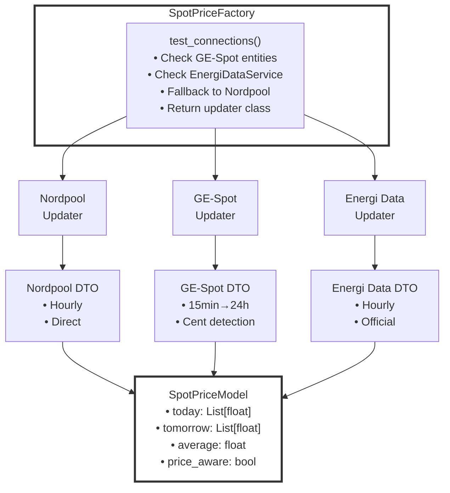

# Spot Price System

**Audience**: Developers using or extending the spot price system  
**Last Updated**: October 2025  
**Version**: 19.12.0+

---

## Overview

The spot price system in peaqevcore provides **automatic detection and integration** of electricity price sources in Home Assistant. It's designed to be extensible, allowing new price sources to be added following established patterns.

---

## Supported Price Sources

| Integration | Regions | Intervals | Status |
|------------|---------|-----------|--------|
| **Nordpool** | Nordic countries (SE, NO, DK, FI) | Hourly (24) | ✅ Stable |
| **Energi Data Service** | Denmark | Hourly (24) | ✅ Stable |
| **GE-Spot** | EU, Nordic, Americas, Asia | 15-min (96) → Hourly | ✅ Since v19.12.0 |

See [Supported Price Sources](SUPPORTED_SOURCES.md) for detailed information.

---

## How It Works

### 1. Auto-Detection

peaqevcore automatically detects which price integration you have installed:

```python
# In your Home Assistant integration
from peaqevcore.common.spotprice.spotprice_factory import SpotPriceFactory

# Factory automatically detects GE-Spot, EnergiDataService, or Nordpool
price_updater = await SpotPriceFactory.create(
    hub=self.hub,
    observer=self.observer,
    system=PeaqSystem.PeaqHvac
)
```

**No configuration needed!** Just install the price integration you want.

### 2. Priority System

When multiple price sources are available, the factory uses this priority:

```
1. GE-Spot        (highest - multi-region, fallback support)
2. EnergiDataService (Denmark-specific, official source)
3. Nordpool       (Nordic countries, well-established)
```

**Exception**: PeaqEv system always prefers Nordpool for legacy compatibility.

### 3. Data Normalization

All price sources are normalized to the same format:

```python
{
    "today": [0.10, 0.12, 0.15, ..., 0.20],  # 24 hourly prices
    "tomorrow": [0.11, 0.13, 0.14, ..., 0.19],
    "average": 0.145,  # Average of today's prices
    "price_aware": True  # Successfully loaded prices
}
```

Different sources, **same output**. Your code doesn't need to know which source is being used.

---

## Architecture

### Component Diagram



### Class Hierarchy

```python
# Abstract Base Classes
SpotPriceBase (ABC)
    - async_update_spotprice()
    - async_set_dto()
    - setup()

ISpotPriceDTO (ABC)
    - set_model()
    - _aggregate_to_hourly()
    - _set_price_in_cent()
    - _set_average()

# Concrete Implementations
NordpoolUpdater(SpotPriceBase)
    └── NordpoolDTO(ISpotPriceDTO)

GESpotUpdater(SpotPriceBase)
    └── GESpotDTO(ISpotPriceDTO)

EnergiDataServiceUpdater(SpotPriceBase)
    └── EnergiDataServiceDTO(ISpotPriceDTO)
```

---

## Usage Examples

### Basic Usage (Automatic Detection)

```python
from peaqevcore.common.spotprice.spotprice_factory import SpotPriceFactory
from peaqevcore.common.models.peaq_system import PeaqSystem

# Let factory detect available source
price_updater = await SpotPriceFactory.create(
    hub=hub,
    observer=observer,
    system=PeaqSystem.PeaqHvac
)

# Use the updater
await price_updater.async_update_spotprice()

# Access normalized price data
today_prices = price_updater.model.today  # List of 24 hourly prices
tomorrow_prices = price_updater.model.tomorrow
average_price = price_updater.model.average
```

### Manual Source Selection

```python
from peaqevcore.common.spotprice.models.spotprice_type import SpotPriceType

# Force specific source
price_updater = await SpotPriceFactory.create(
    hub=hub,
    observer=observer,
    system=PeaqSystem.PeaqEv,
    spotprice_type=SpotPriceType.GESpot  # Force GE-Spot
)
```

### Custom Entity

```python
# Use specific sensor entity
price_updater = await SpotPriceFactory.create(
    hub=hub,
    observer=observer,
    system=PeaqSystem.PeaqHvac,
    custom_sensor="sensor.ge_spot_sweden_se3"
)
```

---

## Data Transformation

### GE-Spot Example (15-minute → Hourly)

GE-Spot provides **96 prices per day** (15-minute intervals). The DTO automatically aggregates to **24 hourly prices**:

```python
# Input: 96 × 15-minute prices
ge_spot_raw = [0.10, 0.11, 0.12, 0.11,  # Hour 0 (00:00-01:00)
               0.12, 0.13, 0.14, 0.13,  # Hour 1 (01:00-02:00)
               ...] # 96 values total

# Output: 24 × hourly prices (average of each hour's 4 intervals)
normalized = [0.11,  # Hour 0: avg(0.10, 0.11, 0.12, 0.11)
              0.13,  # Hour 1: avg(0.12, 0.13, 0.14, 0.13)
              ...]   # 24 values total
```

### Price Unit Detection

DTOs automatically detect if prices are in **cents** or **currency units**:

```python
# Heuristic: If average price > 50, assume cents
if average_price > 50:
    # Convert cents to currency: 150 cents → 1.50 EUR
    prices = [p / 100 for p in raw_prices]
```

---

## State Updates

### Observer Pattern

Price updates are triggered by Home Assistant state changes:

```python
# When sensor updates (e.g., sensor.ge_spot_prices)
async def state_changed(entity_id, old_state, new_state):
    # peaqevcore observer detects change
    await price_updater.async_update_spotprice()
    
    # New prices available
    latest_prices = price_updater.model.today
```

### Update Frequency

- **Nordpool**: Typically updates once per day (~13:00 CET for next day)
- **GE-Spot**: Updates when source data changes (varies by region)
- **EnergiDataService**: Daily updates around 13:00 CET

---

## Error Handling

### Graceful Degradation

```python
# If price source not available
price_updater.model.price_aware  # False

# Safe to check
if price_updater.model.price_aware:
    optimize_based_on_prices()
else:
    use_default_strategy()
```

### Fallback Mechanism

```python
# Factory tries multiple sources
1. GE-Spot → Not found
2. EnergiDataService → Not found
3. Nordpool → Found! ✅

# Always returns a valid updater instance
# Check price_aware to see if prices loaded successfully
```

---

## Testing

### Unit Tests

```python
# Test DTO transformation
def test_gespot_dto_aggregation():
    dto = GESpotDTO()
    # 96 15-minute prices
    raw_data = [0.10] * 4 + [0.20] * 4 + ...
    
    result = dto._aggregate_to_hourly(raw_data)
    
    assert len(result) == 24  # 24 hourly prices
    assert result[0] == 0.10  # First hour average
    assert result[1] == 0.20  # Second hour average
```

### Integration Tests

```python
# Test factory detection
def test_factory_detects_gespot():
    # Mock GE-Spot entity in hass
    factory = SpotPriceFactory()
    
    updater_class = factory.test_connections(
        hass, SpotPriceType.Auto, PeaqSystem.PeaqHvac
    )
    
    assert updater_class == GESpotUpdater
```

---

## Performance

- **Memory**: ~1KB per price source (24-48 float values)
- **CPU**: Minimal - only on price updates (1-2 times per day)
- **Network**: Zero - all data from local HA entities
- **Latency**: <10ms for DTO transformation

---

## Debugging

### Enable Debug Logging

```python
# In Home Assistant configuration.yaml
logger:
  default: info
  logs:
    peaqevcore.common.spotprice: debug
```

### Check Factory Detection

```python
import logging
_LOGGER = logging.getLogger(__name__)

updater = await SpotPriceFactory.create(...)
_LOGGER.debug(f"Using price source: {updater.source}")
_LOGGER.debug(f"Price aware: {updater.model.price_aware}")
_LOGGER.debug(f"Today's prices: {updater.model.today}")
```

---

## Best Practices

### For Integration Developers

1. **Use Auto-Detection**: Let the factory choose the source
2. **Check `price_aware`**: Always verify prices loaded successfully
3. **Handle Missing Data**: Not all users have price integrations
4. **Don't Hardcode Sources**: Support all available sources equally

### For Core Contributors

1. **Follow Patterns**: New sources should match existing implementations
2. **Write Tests**: Comprehensive coverage required
3. **Document Changes**: Update this documentation
4. **Zero Breaking Changes**: Maintain backward compatibility

---

## Related Documentation

- [Supported Price Sources](SUPPORTED_SOURCES.md) - Details on each source
- [GE-Spot Integration](GE_SPOT.md) - GE-Spot specific documentation
- [Adding a New Price Source](ADDING_NEW_SOURCE.md) - Developer guide
- [SpotPriceFactory](FACTORY.md) - Factory pattern details
- [DTO Documentation](DTO.md) - Data transformation layer

---

## FAQ

**Q: Can I use multiple price sources simultaneously?**  
A: The factory selects one source based on priority. Multiple sources can be installed, but only one is used.

**Q: What if my region isn't supported?**  
A: Use GE-Spot - it supports the most regions and has fallback mechanisms.

**Q: How do I force a specific source?**  
A: Pass `spotprice_type=SpotPriceType.GESpot` to `SpotPriceFactory.create()`.

**Q: Can I add my own price source?**  
A: Yes! See [Adding a New Price Source](ADDING_NEW_SOURCE.md).

**Q: What about real-time pricing?**  
A: Most sources provide day-ahead prices. For real-time, you'd need to implement a new source that supports it.
